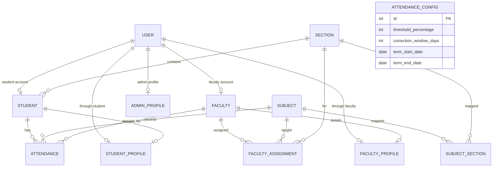

# SAMS Database Schema

## 1. Database overview

The default database engine is SQLite, configured through Django's database settings. Application persistence is managed through Django models and the Django ORM.

The schema separates authentication identity, institutional master data, attendance, attendance configuration, and role-specific profile details.

## 2. Main entities

| Entity / model | Purpose | Key relationships and constraints |
|---|---|---|
| `accounts.User` | Authentication identity and role | Custom Django user; role is one of `ADMIN`, `FACULTY`, `STUDENT`; username is inherited from `AbstractUser`. |
| `masterdata.Section` | Semester section | Unique section name; semester constrained to 1–8. |
| `masterdata.Subject` | Subject catalogue | Unique subject code; semester constrained to 1–8. |
| `masterdata.Student` | Student institutional record | One-to-one with User; unique USN; foreign key to Section; semester 1–8. |
| `masterdata.Faculty` | Faculty institutional record | One-to-one with User; unique employee ID. |
| `masterdata.SubjectSection` | Subject-to-section mapping | Unique `(subject, section)` pair. |
| `masterdata.FacultyAssignment` | Faculty teaching assignment | Unique `(faculty, subject, section)` tuple. |
| `attendance.Attendance` | One student's attendance for a subject/date | Foreign keys to Student, Subject, Faculty; unique `(student, subject, date)`; status Present/Absent. |
| `attendance.AttendanceConfig` | Institution-wide attendance configuration | Singleton-style row (primary key 1); threshold, correction window, term start/end; date and range constraints. |
| `profiles.StudentProfile` | Student personal/guardian/academic profile details | One-to-one with Student; CGPA/SGPA validated on a 0–10 scale. |
| `profiles.FacultyProfile` | Faculty personal/employment profile details | One-to-one with Faculty. |
| `profiles.AdminProfile` | Administrator personal/employment profile details | One-to-one with the configured custom User model. |

## 3. Entity relationship diagram



The profile models are optional one-to-one extensions. The profile view creates the corresponding profile row on first visit when one does not exist. The StudentProfile and FacultyProfile connect to Student and Faculty respectively; those master-data records in turn connect one-to-one to User.

## 4. Attendance constraints and configuration

- Attendance is unique per `(student, subject, date)`.
- Attendance status choices are `P` (Present) and `A` (Absent).
- Attendance timestamps include `marked_at` and `modified_at`.
- `AttendanceConfig` defaults to a 75% threshold and a 7-day correction window.
- The correction window is constrained to 0–365 days.
- Active-term dates must be supplied together for attendance marking; the end date must not precede the start date.
- Attendance dates are checked against the inclusive institution-wide term range by application logic.

## 5. Profile fields

### StudentProfile
`student`, `date_of_birth`, `joining_year`, `current_cgpa`, `current_sgpa`, `address`, `parent_name`, `parent_relationship`, `parent_email`, `parent_contact_no`.

The Student model separately stores `usn`, `name`, `section`, `semester`, and `contact_no`; the linked User stores login identity and email.

### FacultyProfile
`faculty`, `date_of_birth`, `date_of_joining`, `designation`, `personal_email`, `address`.

The Faculty model separately stores `employee_id`, `name`, `department`, and `contact_no`; the linked User stores login identity and institutional email.

### AdminProfile
`user`, `date_of_birth`, `date_of_joining`, `designation`, `contact_no`, `address`.

The linked User stores username, email, and role.

Age is derived from date of birth in model properties and is not persisted.

## 6. Referential integrity and deletion behavior

Foreign-key deletion behavior is defined in the Django models. In particular:
- Student-to-Section uses `PROTECT`, preventing deletion of a section while students still reference it.
- Attendance-to-Subject and Attendance-to-Faculty use `PROTECT`.
- Attendance-to-Student uses `CASCADE`.
- Profile rows are one-to-one dependants and cascade when their linked master record/user is deleted.
- Subject-section mappings and faculty assignments cascade when their related master-data rows are deleted.

Review the model definitions before changing deletion policy; it affects historical attendance and institutional data.

## 7. Migrations

Current application migration files are maintained in each app's `migrations/` package. Apply them with:

```bash
python manage.py migrate
```

Check migration consistency with:

```bash
python manage.py makemigrations --check --dry-run
python manage.py showmigrations
```

Do not manually edit an applied migration. Add a new migration for future schema changes.
